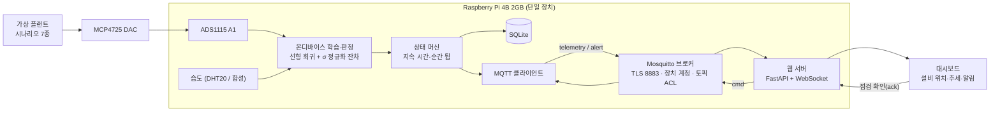
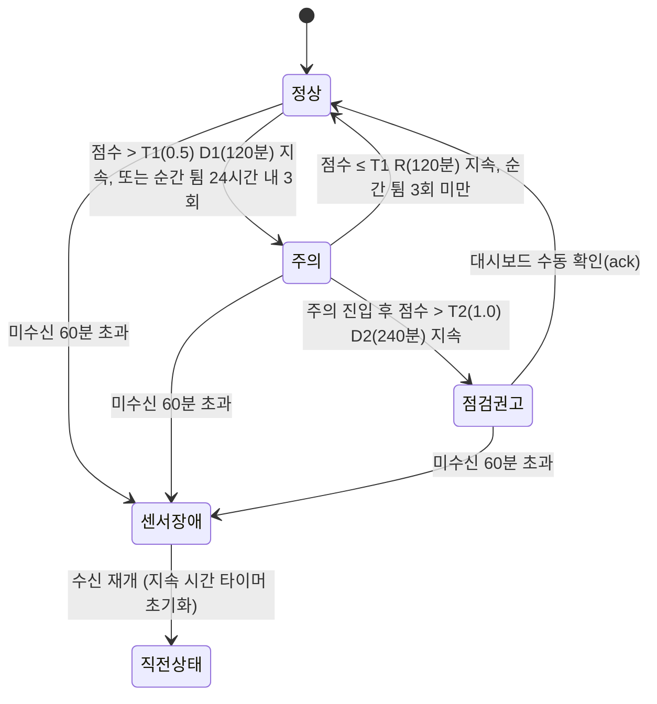
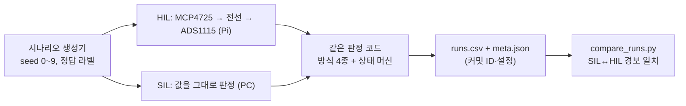

# 논문 진행 계획 (KCI 투고용)

- 목표 투고처: 한국컴퓨터정보학회 논문지 (KCI 등재)
- 작성: 2026-11-12
- 원칙: 실험마다 입력·처리·출력을 고정하고, 결과 파일과 코드 버전을 함께 남긴다 (재현성)
- 범위 밖: 시연·완성도 작업(OLED·LED·버튼, 대시보드 다듬기)은 논문 게재 후 공모전 단계에서 한다

## 1. 주제

1. 제목 후보
   - 국문 - 습도·운전 조건을 반영한 온디바이스 누설전류 추세 감시 시스템의 설계 및 HIL 기반 검증
   - 영문 - Design and HIL-Based Verification of an On-Device Leakage Current Trend Monitoring System Considering Humidity and Operating Conditions
2. 한 줄 요약
   - 습도·가동 상태로 "정상 누설전류"를 예측하고 실제값과의 차이(잔차)로 절연 열화 의심을 판정하는 엣지 장치를, 실전류 시험 없이 SIL → HIL 단계로 검증한다

## 2. 문제와 목적

1. 문제 1 (판정)
   - 내용 - 고정 임계값은 습도·가동에 따른 정상 변동과 실제 열화를 구분하지 못한다
   - 결과 - 습도가 오르면 오경보, 임계값을 높이면 완만한 열화를 늦게 탐지
2. 문제 2 (검증)
   - 내용 - 220V/380V 설비에서 실제 누설을 일으키는 시험은 감전·화재 위험으로 할 수 없다
   - 결과 - 감시 알고리즘의 성능을 안전하고 재현 가능하게 평가할 방법이 필요
3. 목적
   - 운전 조건을 반영한 판정으로 오경보를 줄이고 조기 탐지한다
   - 저가 엣지 장치(Raspberry Pi 4B 2GB) 한 대에서 학습·판정·보안 통신을 수행한다
   - 실전류 없이 SIL → HIL 단계로 성능과 신호 경로를 검증한다

## 3. 연구 질문 (RQ, Research Question)

논문의 모든 실험은 아래 질문 중 하나에 답한다. 답하지 않는 실험은 넣지 않는다.

1. RQ1
   - 질문 - 운전 조건을 반영한 잔차 기반 판정이 고정 임계값·Isolation Forest보다 오경보가 적고 탐지가 빠른가?
   - 답하는 실험 - 실험 1
2. RQ2
   - 질문 - SIL에서 얻은 판정 결과가 실제 하드웨어 신호 경로(DAC → ADC)에서도 유지되는가?
   - 답하는 실험 - 실험 2
3. RQ3
   - 질문 - 저가 엣지 장치에서 학습과 판정이 측정 주기 안에 끝나는가?
   - 답하는 실험 - 실험 3
4. 보조 (RQ 아님, 시스템 요구사항 검증)
   - 내용 - 암호화·장치 인증·토픽 접근 제어가 위조·도청을 막는가
   - 답하는 실험 - 실험 4 (본문 표 1개로 짧게)

## 4. 기여 (서론 끝에 3개로 적는다)

1. 습도·가동을 입력으로 한 정상 모델과 σ 정규화 잔차 점수로, 설비별 절대 기준값 없이 판정
2. 단일 저가 엣지 장치에서 온디바이스 학습·판정·보안 통신을 통합한 감시 시스템
3. 같은 가상 플랜트 모델을 SIL과 HIL에 공통으로 쓰는 단계적 검증 절차와 SIL↔HIL 일치 결과

## 5. 기승전결 → 논문 구성

1. 기 - 1장 서론
   - 담을 것 - 문제 1·2, 목적, RQ, 기여 3개
   - 근거 자료 - 절연 열화와 누설전류 관계 문헌, 기존 누전 감시 방식 한계 문헌 (11장 참고문헌 후보)
2. 승 - 2장 관련 연구, 3장 제안 시스템
   - 2장 - 기존 방식 3갈래(고정 임계값, 통계·비지도 이상 탐지, 엣지 AI 감시)와 빈 곳(운전 조건 반영 + 엣지 학습 + 안전한 검증)
   - 3장 - 시스템 구조, 정상 모델(선형 회귀), 이상 점수(σ 정규화), 지속 시간 상태 머신, 순간 튐 처리, 보안 통신
3. 전 - 4장 실험 및 평가
   - 4.1 검증 환경 - SIL/HIL 구성, 가상 플랜트 모델과 그 근거, 시나리오 7종과 정답 라벨
   - 4.2 실험 1, 4.3 실험 1b(강건성), 4.4~4.6 실험 2~4 결과
   - 4.7 실패 사례 분석 - 제안 방법의 습도 상승 오경보 2/10의 원인(학습 1일 동안 습도 변화가 ±5%p뿐이라 습도 계수 추정 오차가 외삽에서 커짐)
     + 습도 비선형 설비에서 학습 1일이면 습도 상승 오경보 10/10 → 학습 기간이 습도 범위를 덮으면 0 (실험 1b). 남은 한계: 비선형일 때 탐지 시간 증가 → 향후 연구: 비선형 정상 모델
     + Isolation Forest의 한계: 학습 데이터 범위를 벗어나면 점수가 포화돼 "얼마나 이상한가"를 구분 못 함 → 학습 최대값 기준은 seed마다 탐지가 갈리고(각 5/10, F1 seed별 0.27 ± 0.33), 표준 기준(s > 0.5)은 학습 데이터 60개에서 정상 점수도 0.5 근처라 상시 경보(오경보 40/40)
   - "전"인 이유 - 잘된 결과만이 아니라 어디서 왜 틀리는지를 보여야 결과를 믿을 수 있다
4. 결 - 5장 결론
   - 담을 것 - RQ별 답 요약, 한계, 향후 연구
   - 한계 - 합성 데이터, ZCT 센서 응답 미검증(HIL 범위는 ADC 이후), 개루프 HIL, 단일 설비, 학습 기간 1일
   - 향후 연구 - 실설비 데이터, CT 응답 검증, 학습 기간 확장, 비선형 정상 모델(습도 비선형 시 탐지 시간 증가 개선, 2026-11-18 결정: 이번 논문은 한계로 기록)

## 6. 실험 명세 (입력 → 처리 → 출력)

공통 입력 (실험 1·2 동일)

- 시나리오 - 7종 (normal, gradual_rise, humidity_rise, short_spike, repeated_spike, sharp_rise, data_loss)
- 반복 - seed 0~9 (10회)
- 기간 - 가상 14일, 이상 시작 = 가상 1일 00:00
- 판정 설정 - 실험 시작 전 고정한 `config/settings.yaml` (7장)

1. 실험 1: SIL 성능 비교 (RQ1)
   - 입력 - 공통 입력, `hardware: sim`
   - 처리 - 고정 임계값 / Isolation Forest 2종(학습 최대값 기준 `iforest`, 표준 s > 0.5 기준 `iforest_std`) / 선형 회귀 + 잔차(제안)
   - 출력 - 시나리오별 탐지 횟수, 평균 탐지 시간, 오경보 횟수, Precision·Recall·F1
   - 도구 - `python tools/evaluate.py` → `results/exp1_sil/` (runs.csv + meta.json)
   - 그림·표 - `python tools/make_figures.py` → `results/paper/` (표 CSV, 그림 PNG 300dpi). 실험 2·3 결과 파일이 있으면 그 표도 같이 만든다
   - 결과 (2026-11-18, 커밋 전 예비) - F1: 고정 임계값 0.81, IF 학습 최대값 0.35, IF 표준 0.60, 제안 0.97. 오경보 재생: 10/40, 12/40, 40/40, 2/40
1-1. 실험 1b: 강건성 (RQ1 보강, 2026-11-18)
   - 왜 - 합성 데이터의 정상 누설전류가 제안 모델과 같은 구조(습도 선형 + 가동 여부)라, "정답 구조를 아는 모델이 이긴 것" 아니냐는 지적을 막는다
   - 입력 - 그룹 A 모델 불일치(습도 비선형, 노이즈 2·4배) / B 학습 기간 1·3·7일(날씨 습도 변동 ±10%p, 습도 선형·비선형) / C 상승 속도 0.25·1.0mA/일 / D 임계값 조사(고정 임계값 주의선 5.5~9.0mA, sigma_scale 4~20)
   - 도구 - `python tools/robustness.py` → `results/exp1b_robustness/` (4200행, 약 4분), 표·그림은 `make_figures.py`
   - 결과 요약
     - 노이즈 4배, 상승 속도 0.25~1.0 - 제안 방법 F1 0.96~0.97 유지, 고정 임계값 0.75~0.83
     - 임계값 조사 - 어떤 임계값에서도 제안 방법이 "오경보 적고 탐지 빠름" 쪽. 오경보 0회 기준 탐지 시간: 고정 약 160h vs 제안 약 19h (`fig_exp1b_tradeoff.png`)
     - 습도 비선형 + 학습 1일 - 제안 방법도 습도 상승 오경보 10/10 (F1 0.84). 학습 1일의 습도 범위(50~60%)에 급증 구간(60~70%)이 없어서
     - 날씨 변동 + 학습 3·7일 - 습도 선형·비선형 모두 제안 방법 오경보 0/40, 고정 임계값은 비선형에서 40/40
     - 대가 - 습도 비선형 + 학습 3·7일에서 완만한 상승 탐지 시간이 87h·58h로 늘어남 (선형 모델이 곡선을 못 따라가 잔차 σ가 커지고, σ 단위 임계값이 높아짐)
   - 논문 메시지 - 제안 방법의 습도 보상은 "학습 기간이 운전 습도 범위를 포함할 때" 유효하다. 학습 기간 1일은 실험 편의상 값이며, 실제 설치에서는 습도 범위를 덮는 학습 기간이 필요하다
   - 통계 (실험 1, Wilcoxon 부호순위, seed 짝 10개) - 완만한 상승·급상승 탐지 시간, seed별 F1 모두 10/10 seed에서 제안이 우세, p = 0.002 (n=10 양측 정확검정의 최솟값)
2. 실험 2: HIL 검증 (RQ2)
   - 입력 - 공통 입력, 시나리오 값을 Pi DAC→ADC로 통과시킨 측정값 (습도는 시나리오 합성값 고정)
   - 처리 - 제안 방법 (필요 시 3종 모두)
   - 출력 - 실험 1과 같은 지표 + SIL 대비 판정 일치율 + DAC→ADC 오차(평균·최대)
   - 도구 - Pi에서 `bash tools/pi_experiments.sh` 한 번 (사전 점검 → 실험 2 → SIL↔HIL 비교 → 실험 3 → 결과 압축). 실험 2만 약 20~30분
     - 결과 - `results/exp2_hil/` (runs.csv, meta.json에 DAC→ADC 오차 평균·최대, dac_adc_errors.csv 원자료, compare.txt)
     - PC로 가져와 `python tools/make_figures.py` → `table_exp2_agreement.csv`, `fig_exp2_dac_error.png`
3. 실험 3: 온디바이스 처리 성능 (RQ3)
   - 입력 - Pi 4B 2GB, 학습 데이터 1일분(60개)
   - 출력 - 학습 1회 시간, 판정 1회 시간(평균·최대), 측정 주기 대비 여유
   - 도구 - `tools/pi_experiments.sh`에 포함 (`bench.py --out results/bench_pi.json`) → `table_exp3_bench.csv`
   - 측정 항목 (2026-11-18 추가) - 학습 7일분(420개) 시간, 최대 메모리(RSS), Pi면 센서 1회(DAC→ADC) 시간
   - PC 참고값 (x86_64) - 학습 1일 0.6ms / 7일 1.0ms, 판정 0.005ms, 최대 메모리 156MB (Pi 값으로 바꿔 쓸 것)
4. 실험 4: 보안 기능 검증 (보조)
   - 입력 - 공격·대조 케이스 7개 (`tests/test_security.py`)
   - 출력 - 케이스별 차단·허용 결과
   - 도구 - `bash tools/exp4_security.sh` (브로커 실행 → 7개 케이스 → `results/exp4_security/` junit.xml·pytest.log·broker.log·meta.txt) → `table_exp4_security.csv`
   - 결과 (2026-11-18, PC·mosquitto 2.0.18) - 7/7 합격. 평문 접속 응답 없음(브로커: SSL 오류), 틀린 비밀번호 Not authorized, 다른 장치 토픽 위조 발행 Not authorized + 브로커 `Denied PUBLISH`, 웹의 telemetry 위조 Not authorized, 대조군 3개 정상

결과 저장 규칙

- 위치 - `results/실험명/`
- 내용 - 결과 CSV + 실행 정보(커밋 ID, 설정 파일 사본, 실행 일시, 실행 장치)
- 이유 - 논문의 숫자 하나하나를 어떤 코드·설정으로 냈는지 되짚을 수 있어야 한다

## 7. 실험 전에 고정할 값 (변경하면 실험 1·2를 다시 돌린다)

1. 학습 기간 (TBD-02)
   - 제안 - 1일 유지. 시나리오 정상 구간이 1일이라 더 늘리면 학습에 이상 구간이 섞인다
   - 한계 절에 "학습 기간 1일"로 명시
2. Isolation Forest 설정
   - 결정 (2026-11-18) - sklearn 기본 설정(`random_state=0`) + 판정 기준 2종을 모두 보고
     - 이유 - 판정 기준 하나만 쓰면 "비교 방법을 불리하게 보정했다"는 지적을 받는다. 두 기준(우리가 맞춘 기준, 원 논문 표준 기준) 모두 제안 방법보다 F1이 낮으면 결론이 보정 방식에 좌우되지 않음을 보일 수 있다
     - 탐지 시간 그림에서는 IF를 뺀다 (표준 기준은 상시 경보라 탐지 시간 무의미, 학습 최대값 기준은 탐지된 5회만의 평균) → IF는 표로 비교
3. 판정 임계값·지속 시간 (T1, T2, D1, D2, `sigma_scale`)
   - 제안 - 현재 `settings.yaml` 값 고정
4. 고정 방법
   - 값을 확정한 커밋에 태그를 단다 (예: `paper-exp-v1`). 이후 결과 파일에 이 커밋 ID가 찍혀야 한다

## 8. 일정 (안, 투고 마감 확인 후 조정)

- 2026-11-18 변경: 투고를 이번 주(11/22까지)로 당김 → 아래 2~4주차를 이번 주 안에 압축. Pi 실험 2·3이 가장 급하다

1. 1주차 (11/12~11/18)
   - 실험 조건 고정, 결과 저장 기능, 가상 플랜트 모델 근거 문헌 조사, 실험 1 재실행
2. 2주차 (11/19~11/25)
   - Pi 평가 도구·처리 성능 도구 작성, Pi에서 실험 2·3 실행, DAC→ADC 오차 측정
3. 3주차 (11/26~12/02)
   - 결과 분석, 그림·표, 초안 1~5장
4. 4주차 (12/03~12/10)
   - 퇴고, 초록(국·영문), 투고 규정 점검, 투고

## 9. 역할

1. AI (개발자)
   - 결과 저장 기능, Pi 평가 도구, 처리 성능 도구, 그림·표 생성 스크립트
2. 사용자 (SW검증 테스터, 제1저자)
   - 실험 명세 검토(입력·출력·합격 기준), 결과 파일 ↔ 논문 숫자 대조(추적성), 문헌 조사, 본문 작성
3. 팀원 (Pi 하드웨어)
   - Pi 배선, 실험 2·3 실행, DAC→ADC 오차 측정 기록

## 10. 확인 필요

1. 투고 규정 - 분량, 양식, 국·영문 초록 요구, 투고 마감일
2. 가상 플랜트 모델 근거 - 누설전류 정상 범위, 습도 영향, 노이즈 크기를 뒷받침할 문헌
3. 저자 구성 - 팀장포함 2명, 담당교수 1명

## 11. 참고문헌 후보 (2026-11-18 확인)

확인 단계: 서지 = 제목·저자·권호·쪽수가 실제와 맞음 / 원문 = 인용할 문장을 원문에서 직접 확인함

1. 유정현, 김희식, 정용욱 (2018)
   - 서지 - "위상차를 이용한 저항성 누설전류 측정 알고리즘을 적용한 온라인 전기안전 감시시스템의 개발 및 성능시험", 한국안전학회지 33(3), pp. 27-32, doi:10.14346/JKOSOS.2018.33.3.27
   - 확인 - 서지·원문 (PDF 본문)
   - 인용 문장 - "저항성 누설전류는 1.1 mA 이하로 설정", "경보치인 1.1 mA 초과시 동작 경고 알림"
   - 용도 - 1장 문제 1: 국내 IoT 원격감시도 고정 기준값으로 판정한다 (고정 임계값의 실제 사례)
2. 홍순석, 박준열, 이정은, 최경한 (2010)
   - 서지 - "변압기 저압측 중성점 접지선의 누설전류 통합 감시에 관한 연구", 조명·전기설비학회논문지 24(5), pp. 106-113, doi:10.5207/JIEIE.2010.24.5.106
   - 확인 - 서지·원문 (PDF 본문)
   - 인용 문장 - "국내 변전실에서는 일반적으로 각 간선회로마다 ZCT와 ELD를 설치하고 1차 정격전류가 200[mA] 이상 검출될 때 경보를 발하는 방식", "지정 값 이상의 누설전류가 검출되면 관리자에게 경보"
   - 용도 - 1장 문제 1: 현장 관행이 고정 기준값 경보. 이 논문이 인용한 "전기설비 기술기준 제16조"(절연저항 기준)는 표준 근거 후보
3. Dolník, Šárpataky, Kolcunová, Havran (2022)
   - 서지 - "Sensing Method Using Multiple Quantities for Diagnostic of Insulators in Different Ambient Conditions", Sensors 22(4), 1376, doi:10.3390/s22041376
   - 확인 - 서지·원문 일부 (PMC 본문 앞부분)
   - 인용 내용 - 상대습도가 오르면 누설전류가 증가, 60→70%에서 급증, 70% 이상에서는 증가가 완만
   - 용도 - 3장·4.1: 습도가 정상 누설전류를 바꾼다는 근거
   - 주의 - 고압 송전용 자기 애자의 실험실 측정이며 저압 설비 케이블이 아님을 본문에 밝힌다. 관계가 비선형이므로 "선형 모델 가정"의 근거로는 쓸 수 없다 → 비선형 습도 조건의 강건성 실험 근거로 쓴다
4. Hundman, Constantinou, Laporte, Colwell, Söderström (2018)
   - 서지 - "Detecting Spacecraft Anomalies Using LSTMs and Nonparametric Dynamic Thresholding", Proc. ACM SIGKDD 2018, pp. 387-395, doi:10.1145/3219819.3219845
   - 확인 - 서지
   - 용도 - 2장: 예측값과 실제값의 오차로 이상을 판정하고 오경보를 줄이는 같은 계열의 방법. LSTM은 무거워 엣지 학습에 부담 → 본 연구는 운전 조건 입력 + 선형 회귀
5. Ray (2022)
   - 서지 - "A review on TinyML: State-of-the-art and prospects", J. King Saud Univ. - Comput. Inf. Sci. 34(4), pp. 1595-1623, doi:10.1016/j.jksuci.2021.11.019
   - 확인 - 서지
   - 용도 - 1·2장: 센서 데이터를 엣지에서 분석하는 흐름의 배경
6. Lei, Yang, Jiang, Jia, Li, Nandi (2020)
   - 서지 - "Applications of machine learning to machine fault diagnosis: A review and roadmap", Mech. Syst. Signal Process. 138, 106587, doi:10.1016/j.ymssp.2019.106587
   - 확인 - 서지
   - 용도 - 2장: 설비 고장 진단에 ML을 쓰는 연구 흐름의 배경 (진동 신호 중심이라 누설전류와 직접 관련은 없음)
7. Liu, Ting, Zhou (2008) "Isolation Forest", IEEE ICDM 2008
   - 확인 - 미확인 (쪽수 pp. 413-422는 확인 필요)
   - 용도 - 비교 방법의 원 논문. 표준 기준 s > 0.5의 출처 (필수)
8. "Leakage Current Response Mechanism of Insulator String With Ambient Humidity on Days Without Rain" (IEEE, 문서 8688473)
   - 확인 - 미확인 (자동 조회 시 빈 응답, 사용자가 URL 열림만 확인). 저자·학술지·권호와 습도 관계 문장을 원문에서 확인한 뒤 채택

제외 (2026-11-18)

1. MSCRED (Zhang et al., AAAI 2019) - 결함 위치(원인) 진단 논문. 본 시스템은 위치를 추정하지 않고 등록 정보를 쓰므로, 인용하면 없는 기능을 주장하는 것으로 오해됨
2. MCUNet (Lin et al., NeurIPS 2020) - MCU에서 딥러닝 추론. 본 시스템(Pi 4B, 선형 회귀, 장치 내 학습)의 설계 근거가 아님. 엣지 AI 배경은 5번으로 충분

아직 빈 곳: 저압 설비 누설전류의 정상 범위·노이즈 크기 근거, MQTT 보안(OASIS MQTT v5.0), 누설전류·절연 기준(전기설비기술기준 / KEC 해당 조항), HIL·SIL 검증 절차

## 12. 그림 원본 (Mermaid, 2026-11-18)

GitHub에서 이 파일을 열면 그림으로 보인다. 논문용 이미지는 https://mermaid.live 에 붙여 넣고 PNG·SVG로 내려받거나, 이 구조대로 PPT에서 다시 그린다. 조건 값은 `config/settings.yaml`, 전이 규칙은 `src/leakmon/state.py` `update()`와 같다

1. 그림 - 시스템 구조 (3장)

2. 그림 - 상태 전이 (3장)

3. 그림 - SIL·HIL 검증 구성 (4.1)

## 13. 결과 파일 → 논문 위치

`python tools/make_figures.py` 한 번으로 `results/paper/`에 모두 다시 만든다

1. `table_exp1_scenarios.csv` - 4.2 표: 시나리오별 탐지·오경보 횟수, 평균 탐지 시간
2. `table_exp1_metrics.csv` - 4.2 표: Precision·Recall·F1, seed별 F1, 오경보 재생 수
3. `table_exp1_stats.csv` - 4.2 본문: Wilcoxon 검정 (p = 0.002)
4. `fig_exp1_timeseries.png` - 4.2 그림: 습도 상승(오경보)·완만한 상승(조기 탐지) 예시
5. `fig_exp1_delay.png` - 4.2 그림: 탐지 시간 (고정 임계값 vs 제안)
6. `table_exp1b_robustness.csv` - 4.3 표: 모델 불일치·학습 기간·상승 속도
7. `fig_exp1b_tradeoff.png` - 4.3 그림: 임계값별 오경보 vs 탐지 시간
8. `table_exp2_agreement.csv`, `fig_exp2_dac_error.png` - 4.4 (Pi 실행 후)
9. `table_exp3_bench.csv` - 4.5 (Pi 실행 후)
10. `table_exp4_security.csv` - 4.6 표: 보안 케이스 7개
